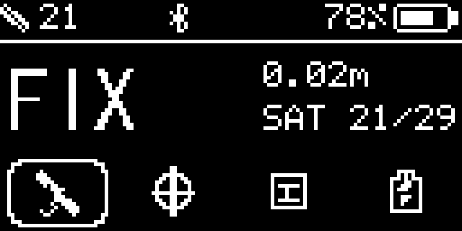
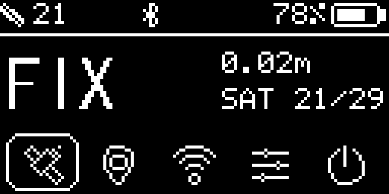
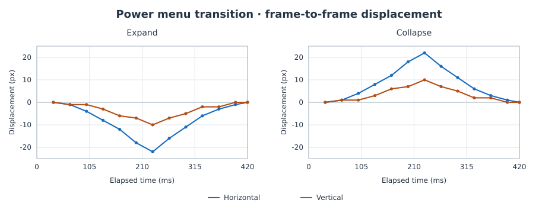

# OL3 OLED UI 打磨

实施于 `feat/ol2-oled-ui` 的 `99d68a4` 工作区。按 A 到 E 顺序完成代码、主机仿真和回归。关机时序同步到本轮授权修改的 ADR-0015 §2.4 与 ADR-0020 §5.3。工程采用 ESP-IDF / C++ T2，SDL2 仿真单独构建。

## A 关机时序

- OLED 在线时，告知、保存、无线收尾及 USB 的断电进行中画面从 Power 首次看到完整帧确认起至少停留 250 ms。保存或静默本身更久时继续等待实际结果或原超时。中间帧故障的兜底时间为阶段起点后 350 ms。
- 电池下电在进入 `kCutPower` 时发布 `POWER OFF`。收到电池终帧确认后至少停留 300 ms，才产生首个 GPIO4 高沿。首段 2 s 从实际高沿起算。100 ms 未确认时记录终帧超时并按原协议断电。
- USB 在 U3 关断后显示 `RESTARTING`。日志放行后保留 30 ms 的绝对终帧等待上限，看到终帧时再留 300 ms。电池、USB 分别确认各自的终帧。无 OLED 时直接走原电源流程。
- U3 未关断的 30 s 回退仍从进入 `kCutPower` 起算，trace 使用同一起点。 [ADR-0015](../adr/ADR-0015-board-profiles.md#L80) · [ADR-0020](../adr/ADR-0020-oled-display.md#L135)

## B 仿真器

`tools/oled_sim` 使用 SDL2 2.32.74、真实 OLED UI/动画和 WouoUI 图形层。发送回调保存 128×64 的页缓冲，窗口默认放大 6 倍。两组 headless CTest 导航五个子页、模拟关机以及触发通信确认弹窗，逐字节比较关键 PBM。SDL dummy 驱动窗口路径可启动并稳定运行至测试超时。 [构建、按键与截图命令](../../tools/oled_sim/README.md) · [SDL 窗口测试](../../builds/ol9-logs/sdl-window.log)

## C 五个入口图标

自绘 16×16 位图存于 `OledIcons.hpp`，五格同一尺寸和对齐线。单像素描边随当前选择移动。截图使用同一个 RTK Fixed 场景。

改画前

改画后

## D 通信与配对

通信页显示蓝牙已连数，或 SoftAP 当前 SSID 及关联终端数。开窗沿用 60 秒默认时长并启用逐次确认，显示剩余秒数。GAP 待确认快照包括请求序号、地址后 3 字节、可用的 SSP 数字及异步取得的设备名。名字未返回时显示地址后缀。OLED 读取 DataCenter 快照，决策由 kLink 提交。后端按请求序号拒绝迟到的决定，30 秒到期后自动关闭弹窗。

切到 Wi-Fi 使用 `radio wifi` 共用的重启仲裁和 RTC 模式请求。退出已运行的 Web 模式复用 GGA 持久化检查、客户端 `bye` 和 BT 重启。Web 服务启动失败的 Wi-Fi 档使用已有的 BT 模式请求返回。 [蓝牙通信页](ol3/bluetooth.png) · [Wi-Fi 通信页](ol3/wifi.png) · [切换确认](ol3/wifi-confirm.png) · [配对确认](ol3/pair.png)

| 页面 | 单击 | 双击 |
| --- | --- | --- |
| 自检 | 无动作 | 跳过到表盘 |
| 表盘 | 移到下个入口 | 打开当前入口 |
| 卫星子页 | 切换星座与 CN0 | 返回表盘 |
| 定位、设备、电源子页 | 无动作 | 返回表盘 |
| 通信页 | 循环选择模式、配对窗口和 Back。Wi-Fi 档提供模式和 Back | 执行当前项，Back 回表盘 |
| Wi-Fi 切换确认 | 取消 | 确认切换重启 |
| 任意页的配对弹窗 | 拒绝，回到原页 | 接受，回到原页 |
| 充电待机与关机页 | 无动作 | 无动作 |

单击在 300 ms 窗口后确认。2.5 秒长按仍在正常档关机，在充电待机触发开机。

## E 过渡动画

420 ms 定点 `easeInOutCubic`，内容迟 40 ms 开始上移 5 px，返回使用镜像时间。仿真器对最远的电源入口按 33 ms 采样，展开及收回各有 13 个活动帧和 420 ms 终点。两方向最大相邻位移均为横向 22 px、纵向 10 px，宽度变化 23 px、高度变化 10 px。纯逻辑测试另检查全宽滑动每步 ≤32 px，及展开/收回的逐点镜像。沿用 8 ms 每页超时传参预算。实板 FPS、最坏持锁时长待测。 [逐帧位移 CSV](ol3/transition.csv) · [展开选帧](ol3/expand.png) · [收回选帧](ol3/collapse.png) · [完整仿真序列](../../builds/ol9-sim-transition/frames.csv)

## 回归和变异

| 范围 | 正向断言 | 变异被拦下的条件 |
| --- | --- | --- |
| A | 电池终帧成功与超时、USB 停留、实际首段脉冲、关机回退 trace、真实驱动部分页补写 | 放行提前 GPIO4、取消 300 ms 停留和取消告知页停留 |
| B | 自检到各子页及关机的 PBM Golden 比对 | 移除 WouoUI 帧发送 |
| C | 五入口布局与表盘 Golden 帧 | 用定位图标覆盖通信图标 |
| D | 默认确认开窗、先确认再切换、地址和数字快照、过期和拒绝、Web `bye` 与 BT 重启 | 跳过 Wi-Fi 确认或不携带请求序号 |
| E | 33 ms 几何步长、420 ms 终点、内容行程及时间镜像 | 还原 ease-out 或取消内容上移 |

9 个隔离重链变异均被拒绝。正向覆盖包括主机和 ASan/UBSan，以及 t13 的 SPP/GAP 替身。 [变异日志](../../builds/ol9-logs/mutations.log) · [主机定向日志](../../builds/ol9-logs/main-host-preflight.log) · [关机终帧](ol3/power-off.png)

## 门禁、体积与实板验证

**PASS，43 项通过，0 项失败。** 实际命令为 `ASAN_OPTIONS=detect_leaks=0 bash tools/ci/run_gates.sh --prefix ol9 --base 78e5801`。主机普通及 ASan/UBSan 各 14 组，其中 OLED 主机套件各 167/167，SPP/GAP 套件各 46/46。七个固件配置和两个 `rtk_pure` 目标构建通过，冻结校验、格式、文档、clang-tidy、运行时符号和 CLI 依赖检查也通过。clang-tidy 扫描 159 个源文件，0 项发现。 [全量门禁日志](../../builds/ol9-logs/ol3-gates.log) · [clang-tidy 日志](../../builds/ol9-logs/G5b-tidy.log)

基线与 OL3 使用逐字节一致的 `sdkconfig`。静态 DRAM 增量为 152 B，满足 1 KiB 上限。 [基线 map 统计](../../builds/ol9-logs/ol9-baseline-idf-size.log) · [OL3 map 统计](../../builds/ol9-logs/ol9-idf-size.log)

| 指标 | 基线 `99d68a4`（B） | OL3（B） | 增量（B） |
| --- | ---: | ---: | ---: |
| `rtk_main.bin` | 1,560,144 | 1,564,864 | +4,720 |
| DRAM `.data` + `.bss` | 97,651 | 97,803 | +152 |
| IRAM | 116,139 | 116,139 | 0 |
| Flash 指令 | 1,118,064 | 1,122,276 | +4,212 |
| Flash 数据 | 273,324 | 273,708 | +384 |

实板掉电和重启时序、蓝牙对端名称解析、OLED 实测帧率、I2C 持锁和任务栈 HWM 为 **NOT_RUN**。工作区保留改动；未提交、未烧录、未访问串口。
