# OL4 OLED 交互与排版

实施于 `feat/ol2-oled-ui`（基于 `75f3c43`），门禁前缀 `ol11`。参考 `GNSS_Panel` 的启动待机、主表盘与“左主卡 + 右列表 + 末尾左箭头 Back”子页版式，结合 P2 128×64 单色 SH1106 与单按键约束，按 A–E 逐项完成代码、仿真器、Golden 回归与文档同步，并闭环修复 OL4 验收发现的 5 项问题。

## A 长按关机：进度提示 + 确认（防误触）

- **按键阈值与只读快照**：`PowerLogic.hpp` 将短按上界 `kKeyShortMaxMs` 与浮层起点 `kKeyHoldOverlayStartMs` 统一为 600 ms，并新增 `PowerKeySm::{holding, pressStartMs, longPressMs}`、`StandbyWakeSm::{active, startedMs}` 只读访问器与 `kForcePowerOffHoldMs = 8000 ms` 强制关机兜底阈值；`UiEventBus` 通过标准无锁 seqlock（写端首次 seq 存储后加 `memory_order_release` fence、读端校验前加 `memory_order_acquire` fence）暴露 `KeyHoldSnapshot`，并新增单生产者单消费者 `notifyLongKey / popLongKey` 通道。
- **长按进度浮层（600→2500 ms）**：正常模式按住 ≥ 600 ms 时，在当前页面之上叠加电源图标 + 进度条 + `HOLD TO POWER OFF` 浮层，线性填充 600→2500 ms；未满 2500 ms 松开后 150 ms 收缩收起，不触发短按且不关机。
- **二次确认页（`POWER OFF?`）**：按住满 2500 ms 进入确认页，显示 `2x=OK  1x=CANCEL` 与 5 s 倒计时条（超时自动取消）；单击取消、双击确认后经 `OledAction::kShutdownKey` 调用 `power::requestShutdown(kKey)`。确认页显示期间，蓝牙配对弹窗自动排队，退出确认页后再弹出。
- **强制关机兜底与离线/无 OLED 回退**：低电、console、网页/手机来源直接进入关机页且首行标示原因（`LOW BATTERY` / `CONSOLE` / `KEY`）；OLED 卡死或未消费长按时，正常模式持续按住达 `kForcePowerOffHoldMs = 8000 ms` 由 `PowerModule` 不经 UI 直接调用 `power::requestShutdown(kKey)`；OLED 面板连续 4 次 I2C 刷屏失败进入离线态时清除 `kOledActive`（恢复写出后重新置位），与 `Feature::kOled` 关闭同样退回 2.5 s 直接关机，由主机用例 `power_long_key_no_oled`、`power_force_off_fallback`、`power_oled_offline_direct_shutdown` 与 `oled_module_offline_clears_oled_active` 覆盖。
- **ADR 同步**：仅更新 [ADR-0015 §2.4](../adr/ADR-0015-board-profiles.md) 按键/关机段与 [ADR-0020 §5.2–5.4](../adr/ADR-0020-oled-display.md) 交互/关机段。

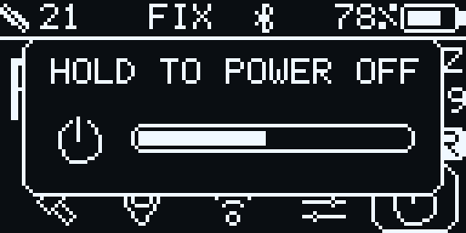 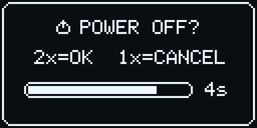

## B 充电待机页重做

- **左区电量与状态**：顶行显示 `CHG` / `FULL` / `USB`（可用时同排显示电池电压），中部以 `Font_12_24` `NumberRoll` 显示大号百分比与 `%`，下方绘制圆角电池进度条；充电且未满时以 ≤ 2 fps（`kChargeAnimPeriodMs = 500 ms`）缓慢流动条纹，充满后立即停止流动恢复静止零写入。
- **右区开机保持环**：电源图标外围绘制进度环与 `HOLD 2s ON` 提示；按住按键时按 `StandbyWakeSm` 起点与 2 s 阈值实时填充，未满松开时平滑回落至 0。
- **底行版本**：底部分隔线下居中显示 `FW <fw>  HW <hw>`。
- **仿真器与 Golden**：`tools/oled_sim` 新增数字键 `9` 与 `--boot standby` 启动模式，及 `scripts/standby.txt` 对应的 4 张 headless Golden（静止、流动、按住填充、松开回落）。[仿真器说明](../../tools/oled_sim/README.md)

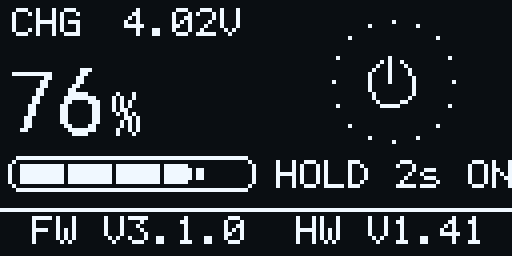 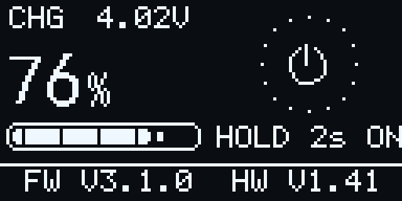
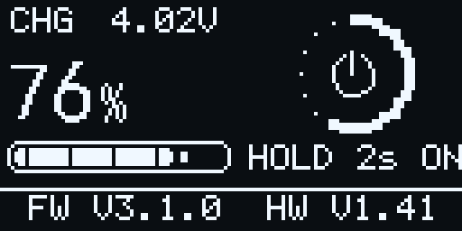 

## C 子页面排版统一

- **统一框架**：所有统一子页顶部沿用 10 px 状态栏（卫星数、解状态、BT/Wi-Fi、电量），下方左侧为 40×52 圆角主卡（16×16 图标 + 关键值 + 辅助短词），右侧为最多 3 行可见的可滚动列表（7×8 图标 + 名称 + 右对齐值），超过 3 行时右侧绘制 3 px 滚动指示条，末尾统一为左箭头 `Back` 项。
- **位置页**：主卡为定位图标 + 解状态（`FIX/FLOAT/DGPS/SPS/NONE`）+ 精度；列表为纬度、经度、`ALT`、`HA`（HDOP 与差分龄期）、`Back`。
- **卫星页**：保留 4 星座两段柱状图（外框可见、内实心已用，柱顶 `used/vis`、柱底系统名）及 CN0 视图，顶栏显示 `used/visible` 与 `1/2` / `2/2`。
- **通信页**：主卡为 BT/Wi-Fi 16×16 图标 + 当前模式与连接数；BT 列表为模式切换、配对窗口倒计时/开启、已连设备后 3 字节地址（`Dev`）、`Back`；Wi-Fi 列表为模式切换、SoftAP SSID（`AP`）、`Back`。
- **设备页**：主卡为设备图标 + 产品名 + 硬件版本；列表为 `FW`、`SN`、RF 图标 + 完整 BT/AP 设备名（省去多余文字标签避免 `P2-P2000123` 截断）、`UP` 运行时间、`Back`。
- **电源页**：主卡为实时电量垂直电池图标 + `NumberRoll` 百分比 + 状态短词；列表为 `VOLT`、`CHG`、`USB`、`Power off`（双击弹出 A 的确认页）、`Back`。

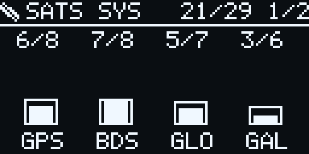 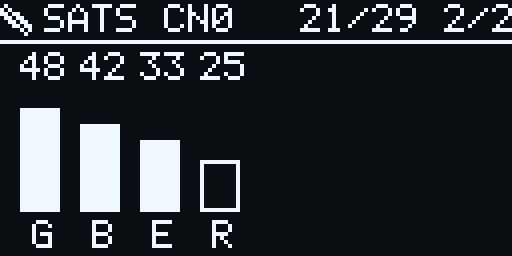
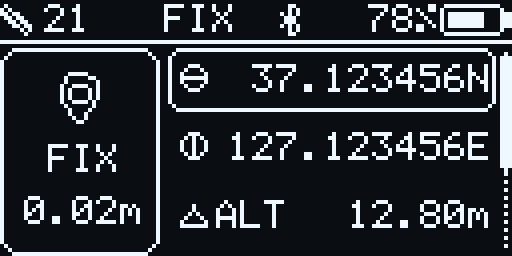 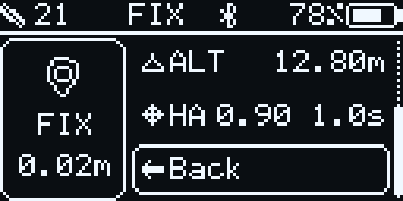
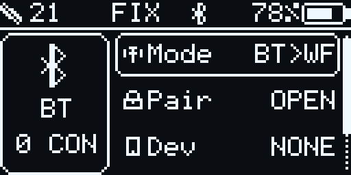 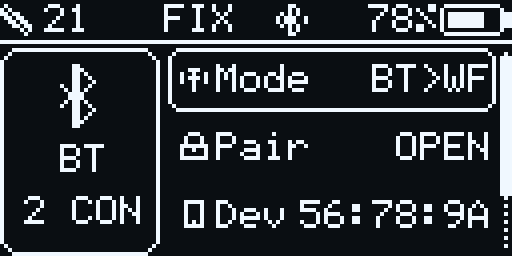
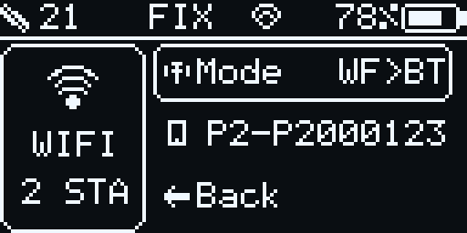 
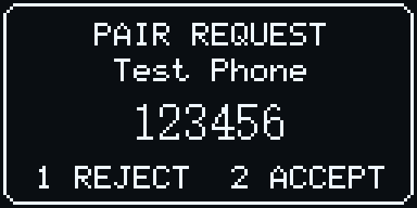
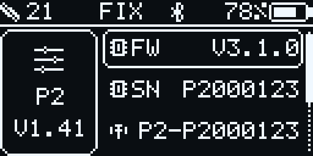 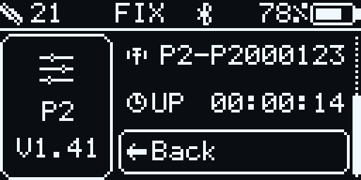
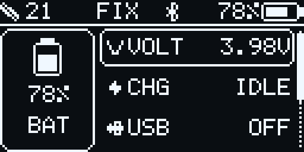 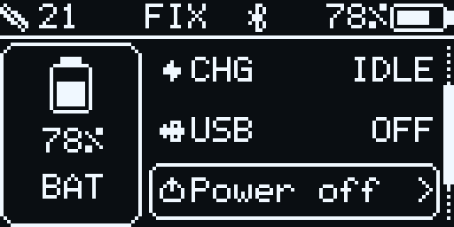

## D 选择与切换动画

- **弹簧选择跟随与平滑滚动**：复用 `OledAnim` 定点 `FixedSpring`（行间刚度 `kRowStiffness = 2800`、阻尼 `kRowDamping = 94`、8 ms 子步），单行 17 px 位移在 165 ms 内无过冲收敛（≤ 180 ms）；列表滚出视口时 `subScrollSpring_` 同步平滑跟随而非跳行。
- **双击挤压/回弹反馈**：`SquishAnim` 在双击确认时令选中框内缩 2 px 再回弹至原尺寸，总时长 120 ms。
- **展开/收拢与错峰上移**：子页进入沿用 OL3 420 ms `easeInOutCubic` 从表盘图标展开，内容行按行号每行延迟 40 ms 上移 `kTransitionContentLiftPx = 6 px`；返回表盘采用镜像时间收拢回原图标。
- **数值滚动与零写入**：电量百分比等动态数值使用 `NumberRoll`；静止态（除充电待机 ≤ 2 fps 流动动画外）保持 0 次 I2C 写入，8 ms 每页写锁预算与 30 fps 帧率上限不变。

## E 其他打磨

| 项 | 分析与实现 | 验证 |
| --- | --- | --- |
| 表盘 UTC 与卫星数 | GNSS 运行且 UTC 有效时，表盘右侧首行显示 `HH:MM:SSZ`、次行紧凑显示 `x.xxm used/vis`（如 `0.02m 21/29`），同时顶部状态栏稳定显示已用卫星数；无 UTC 时回退精度 + 卫星数。 | `dial.png` + `OledUiCheck` |
| 表盘解状态滚动 | `UiController` 追踪 `heroPrevBadge` 与 180 ms `heroRollQ10`，解状态变化时在 64×24 裁剪区内纵向滚动切换。 | `OledUiCheck` |
| Dock 选中入口名 | 选中图标上方 `y = 35` 绘制反白胶囊入口标签（`SATS`/`POS`/`COMM`/`DEVICE`/`POWER`），明确区分入口名与数据区，随 `dockFocusX` 水平跟随并钳制屏边。 | `dial.png` + `OledUiCheck` |
| 关机页重做 | 首行左侧显示原因（`KEY` / `LOW BATTERY` / `CONSOLE` 等）、右侧显示终态；进度环右侧显示阶段名、进度条，及保存/射频/断电 3 个 7×8 小图标勾选/降级标记。 | `shutdown.png` + `OledUiCheck` |
| 开机自检打勾动画与分页滚动 | `SystemCheckSm` 记录各项完成时间戳 `itemResolvedMs`，180 ms 内先画左短钩再补全完整对勾；每屏最多 4 行、行距 10 px 并配右侧滚动条，与底部进度条留出间距，避免 6×8 字体粘连。 | `boot.png` + `boot-check.png` |
| 60 s 无操作自动回表盘 | `kInactivityReturnMs = 60000U`（常量可调）；位于子页且无按键、无弹窗、无长按浮层满 60 s 时自动以收拢动画返回表盘。 | `OledUiCheck` |

 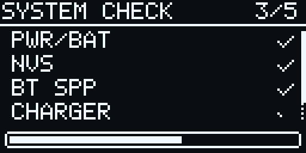
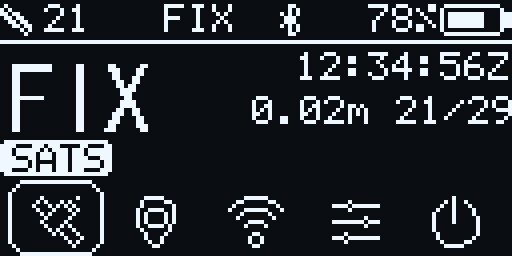 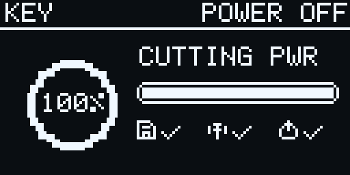

## 门禁、测试与体积

**PASS：43 passed, 0 failed。**

执行命令：

```sh
ASAN_OPTIONS=detect_leaks=0 bash tools/ci/run_gates.sh --prefix ol11 --base 75f3c43
```

- **主机回归与 ASan/UBSan**：全部 14 组普通与 14 组 ASan/UBSan 套件通过，其中 `main_host_check` 为 **175/175**（覆盖长按 < 2.5 s 释放不关机、2.5 s 进入确认页单击取消/双击确认/5 s 超时取消、UI 不消费长按时 8 s 强制关机兜底、OLED 连续 4 次 I2C 失败清除 `kOledActive` 与离线后 2.5 s 直接关机、确认页压制配对弹窗排队、无 OLED 构建直接 2.5 s 关机、充电待机按住环填充与松开回落、行弹簧 ≤ 180 ms 收敛、挤压动画 ≤ 120 ms、60 s 无操作回表盘，以及 `tour` / `comm` / `standby` 共 23 帧 PBM 逐字节 Golden 比对）。
- **静态检查与固件构建**：`G1-frozen` 通过；`G5-format`、`G6-doc_check`（82 个改动函数 0 不合格）、`G5b-tidy`（159 个源文件 0 条发现）、`G7b-runtime`（0 堆分配）、`G7c-no-cli-deps` 全部通过；7 个 ESP-IDF 配置与 2 个 `rtk_pure` 目标（`esp32` / `esp32c3`）均 0 警告构建通过。[全量门禁日志](../../builds/ol11-logs/ol4-fix-gates.log) · [OL4 size 统计](../../builds/ol11-logs/ol11-idf-size.log)

相对基线 `75f3c43`（[OL3 size 统计](../../builds/ol9-logs/ol9-idf-size.log)）的体积增量：

| 指标 | 基线 `75f3c43`（B） | OL4（B） | 增量（B） | 约束 |
| --- | ---: | ---: | ---: | --- |
| `rtk_main.bin` | 1,564,864 | 1,572,784 | +7,920 | 报告 |
| DRAM（`.data` + `.bss`） | 97,803 | 97,971 | +168 | ≤ 1,024 B（PASS） |
| IRAM | 116,139 | 116,139 | 0 | 0 B（PASS） |
| Flash 指令（`.text`） | 1,122,276 | 1,129,876 | +7,600 | 报告 |
| Flash 数据（`.rodata` 等） | 273,708 | 273,964 | +256 | 报告 |
| 运行时堆分配 | 0 | 0 | 0 | 0 B（PASS） |

## 未实测项（`NOT_RUN`）

- 实板 SH1106 实测帧率（动画峰值与充电待机 ≤ 2 fps）及单页 I2C 最坏持锁时长。
- 实体按键长按 600→2500 ms 浮层与双击确认手感，以及充电待机按住 2 s 唤醒实机体验。
- 真实硬件 U3 掉电/重启时序与蓝牙实机对端设备名解析。
- OLED 任务实板栈高水位（HWM）。

工作区已保留全部改动；未执行 `git commit`、`git stash`、烧录或串口访问。

## OL4-HIL 上板修复（基于 `79afdcd`）

针对 P2 实板上板 HIL 暴露的 4 项问题完成根因修复与主机回归验证：

| # | 问题与根因 | 修复内容 | 验证 |
| --- | --- | --- | --- |
| 1 | **充电待机唤醒回弹**：`PowerModule::handleChargeStandbyPowerOn` 确认保持进入 `restartPending_` 后，`standbyWake_.active()` 变为 `false`，`UiController::stepChargeStandby` 触发衰减分支，唤醒环满圈后又回退至 ~50% 再重启。 | `PowerModule::poll` 在 `kChargeStandby && restartPending_` 时继续向 `uiEvents.updateKeyHold` 传入 `standbyConfirm=true`；`UiController` 进入确认锁定态后保持环 100% 满圈并显示 `STARTING` 直至重启（不受按键松开回落影响）。 | `OledUiCheck`、`MainHostCheck` + `standby-starting.png`（24 帧 Golden 全过） |
| 2 | **无充电芯片板状态栏不显示充电图标**：当前测试板无充电 IC（0x1A 无应答），原状态栏仅在 `vm.charging` 时画闪电。 | `OledDef` 区分外接 USB 与电池电源，`OledRender` 顶部状态栏在 `vm.usbPresent && !chargerPresent` 时显示 USB 插头图标，充电 IC 在线且充电中保留闪电图标；电源子页同步显示 `USB` / `CHG` / `BAT`；`PowerModule::publishSnapshot` 在 `usbPresent` 边沿变化时主动触发 `uiEvents.notifyWake()` 立即刷新屏幕。 | `OledUiCheck`、`MainHostCheck` |
| 3 | **切 Wi-Fi 重启后黑屏（I2C 锁死 + 静默初始化失败 + 软重启未静默）**：软重启切射频时未向 OLED 刷过渡帧并静默 I2C，可能截断事务致 SH1106/SDA 卡低；`I2cBus` 缺少 SDA 卡低 9 SCL 脉冲 + STOP 恢复；`Sh1106` 探测失败未记录阶段且无后台恢复。 | ① `I2cBus` 在 `ensureInit`/`resetBus` 检测 SDA 为低时手动发 9 个 SCL 脉冲 + STOP 释放总线，`probe` 对超时/NACK 执行 ≥2 次复位重试；② `Sh1106` 记录失败阶段与错误码并在首次失败打印 `W` 日志，`oled` CLI 新增 `init` 阶段/错误/重试次数输出，`OledModule` 任务在面板离线时后台周期重试恢复（不阻塞启动）；③ 新增 `RadioMode::restartWithOledQuiesce`，在射频切换/Web 退出/OTA/恢复出厂/`sys reboot` 等软重启路径先让 OLED 刷出过渡帧（如 `SWITCHING WI-FI` / `SWITCHING BT` / `REBOOTING`）并在 ≤300 ms 预算内静默 I2C 后再 `esp_restart()`；④ Wi-Fi 模式正常执行自检后进入表盘。 | `ChargerCheck`、`OledDriverCheck`、`OledModuleCheck`、`OledUiCheck` |
| 4 | **F9P 无定位时精度显示 `655.34m`**：F9P 无定位时 GST 仍输出极大标准差，解析层饱和为 `65534 cm`；UI 未按 `vm.fixValid` 门控且未上限钳制。 | 仅在 UI 渲染层修复（不改解析器语义）：`OledRender` 的表盘右侧、位置子页及所有 `hAccCm` 显示点仅在 `vm.fixValid` 时输出精度，无定位显示 `NO FIX` / `ACC --`；`hAccCm >= 9999`（含饱和值 `65534`）统一显示 `>99m`。 | `OledUiCheck`（覆盖 `fixValid=false+65534`、`fixValid=true+65534`、`fixValid=true+2`） |

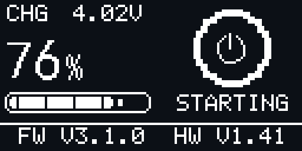

### OL4-HIL 门禁与体积（`ol12`，相对基线 `75f3c43`）

**PASS：43 passed, 0 failed。**

```sh
ASAN_OPTIONS=detect_leaks=0 bash tools/ci/run_gates.sh --prefix ol12 --base 75f3c43
```

- **主机与 ASan/UBSan**：全部 14 组普通 + 14 组 ASan/UBSan 通过，其中 `main_host_check` 为 **181/181**（新增充电待机 `STARTING` 锁定、USB 插头指示与拔插唤醒、I2C 9-SCL 恢复与 `probe` 复位重试、OLED 离线后台恢复、软重启 OLED 过渡页与静默握手、F9P 无定位/`>99m` 精度显示回归，以及 `standby-starting.pbm` 纳入 24 帧 Golden 比对）。
- **静态检查与固件构建**：`G1-frozen`、`G5-format`、`G6-doc_check`（122 个改动函数 0 不合格）、`G5b-tidy`（159 个源文件 0 条发现）、`G7b-runtime`（0 堆分配）、`G7c-no-cli-deps` 及 7 个 ESP-IDF 配置 + 2 个 `rtk_pure` 目标（`esp32`/`esp32c3`）全部通过。[全量门禁日志](../../builds/ol12-logs/ol4-hil-gates.log) · [ol12 size 统计](../../builds/ol12-logs/ol12-idf-size.log)

| 指标 | 基线 `75f3c43`（B） | OL4-HIL `ol12`（B） | 增量（B） | 约束 |
| --- | ---: | ---: | ---: | --- |
| `rtk_main.bin` | 1,564,864 | 1,576,048 | +11,184 | 报告 |
| DRAM（`.data` + `.bss`） | 97,803 | 97,995 | +192 | ≤ 1,024 B（PASS） |
| IRAM | 116,139 | 116,139 | 0 | 0 B（PASS） |
| Flash 指令（`.text`） | 1,122,276 | 1,132,828 | +10,552 | 报告 |
| Flash 数据（`.rodata` 等） | 273,708 | 274,252 | +544 | 报告 |
| 运行时堆分配 | 0 | 0 | 0 | 0 B（PASS） |

- **待上板复验（`NOT_RUN`）**：实板充电待机长按唤醒视觉无回弹、无充电 IC 实板插拔 USB 状态栏切换、反复切 Wi-Fi/BT 软重启 I2C 不黑屏及 F9P 实机无定位精度显示。
